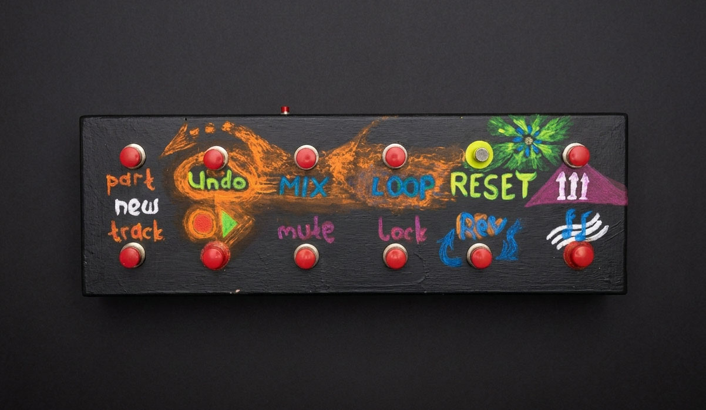
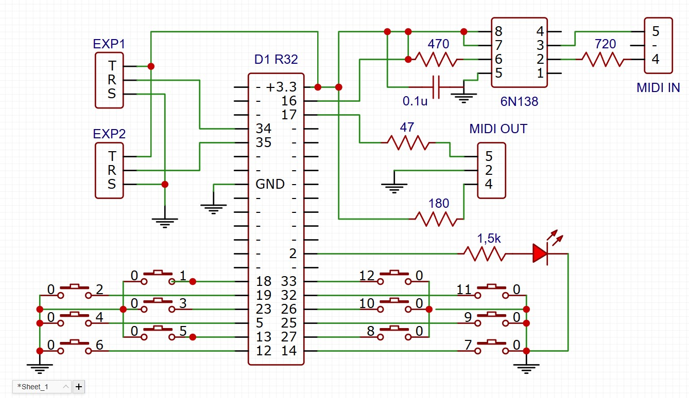
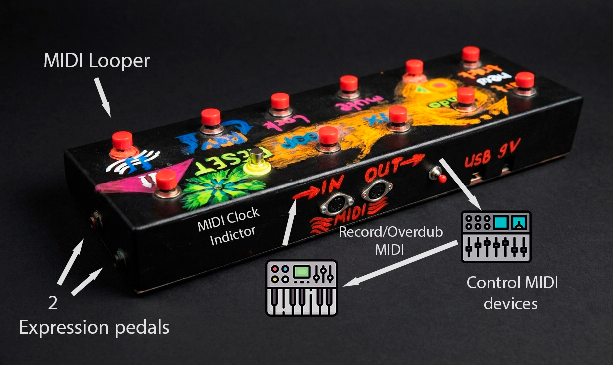
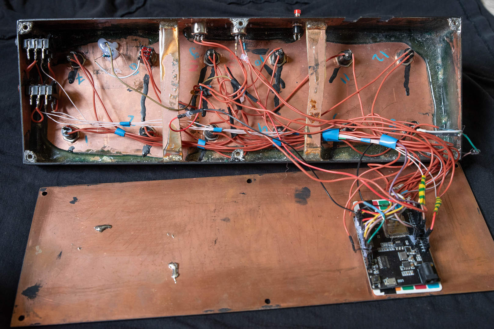

# MIDI Footswitch + Looper (ESP32-S3-Zero)

DIY MIDI-футсвитч с лупером на плате Waveshare ESP32-S3-Zero. Работает с Zynthian как обычное USB MIDI-устройство
(плюс DIN MIDI), а по BLE подключается к приложению лупера на телефоне.

Демо прототипа (старая версия): https://youtu.be/_LKqkmQQmJw

> Старая версия для WEMOS D1 R32 (Arduino IDE): [dmtry3/_old_footswitch](https://github.com/dmtry3/_old_footswitch) (архив).



## Что умеет
- 11 кнопок шлют MIDI CC 21–31 на канале 12 (127 при нажатии, 0 при отпускании)
- 2 педали экспрессии шлют CC 30 и 31 на канале 11
- Лупер: запись и воспроизведение MIDI, педаль на отдельном пине
- Синхронизация по MIDI-клоку (от Zynthian)
- Пресеты в памяти платы (LittleFS)
- BLE-сервер для приложения лупера

## Лупер
Управляется одной педалью (GPIO14).

- **Запись.** Первое нажатие ставит запись в ожидание, и она начинается с первой доли следующего такта.
  Второе нажатие так же по такту завершает запись и включает воспроизведение.
- **Овердаб.** Во время воспроизведения нажатие включает наложение нового слоя, следующее нажатие выключает его.
- **Сброс.** Удержание 1,5 с очищает луп, останавливает воспроизведение и гасит звучащие ноты.
- Записываются ноты и CC. Каналы 11 и 12 (экспрессия и кнопки футсвитча) в луп не пишутся.
- Если во время воспроизведения крутить ручку, записанные CC этой ручки на время замолкают, чтобы не спорить с рукой.

### Синхронизация
- Темп и такт берутся из внешнего MIDI Clock. `MIDI Start` и `MIDI Continue` сбрасывают счёт тактов.
- Если клока нет дольше 1,2 с, работает внутренний генератор (по умолчанию 110 BPM).
- Клок и Start/Stop/Continue обратно в Zynthian не пробрасываются, чтобы не было петли.

### Светодиод
Работает как метроном:
- **Ожидание и воспроизведение**: короткие вспышки. Первая доля такта длинная и яркая (120 мс), остальные короткие и тусклые (45 мс).
- **Запись и овердаб**: горит постоянно и резко гаснет на долях.
- **Ожидание старта или стопа по такту**: мягко пульсирует.
- **Педаль удерживается дольше 0,5 с**: быстро пульсирует, предупреждая о сбросе.

## Кнопки и экспрессия
- Защита от дребезга программная, для каждой кнопки отдельно.
- Сигнал педалей экспрессии сглаживается фильтром Калмана, поэтому значения меняются плавно и без шума АЦП.

## Подключение

| Назначение | Пин |
|---|---|
| Кнопки 1–11 (CC 21–31) | GPIO3, 4, 5, 6, 7, 8, 9, 10, 11, 12, 13 |
| Педаль лупера | GPIO14 |
| Экспрессия 1 / 2 | GPIO1 / GPIO2 |
| Светодиод (внешний, через резистор) | GPIO15 |
| DIN MIDI RX / TX | GPIO44 / GPIO43 |

USB MIDI идёт через разъём USB-C на плате.

### Схема
Схема нарисована для старой платы D1 R32, но внешняя обвязка та же. Меняются только пины:

| На схеме (D1 R32) | Сейчас (ESP32-S3-Zero) |
|---|---|
| 18 (педаль лупера) | GPIO14 |
| 19, 23, 5, 13, 12, 14, 27, 25, 26, 32, 33 (кнопки) | GPIO3 … GPIO13 |
| 34 / 35 (экспрессия) | GPIO1 / GPIO2 |
| 2 (светодиод) | GPIO15 |
| 16 (MIDI IN, с оптрона 6N138) | GPIO44 |
| 17 (MIDI OUT) | GPIO43 |

- Кнопки замыкают пин на землю (внутренняя подтяжка включена).
- Экспрессия: TRS-джек, T на +3,3 В, R на вход АЦП, S на землю.
- Светодиод через резистор 1,5 кОм.
- MIDI IN: оптрон 6N138, 720 Ом на входе от DIN, 470 Ом подтяжка выхода к +3,3 В, 0,1 мкФ по питанию.
- MIDI OUT: 47 Ом от TX на контакт 5, 180 Ом от +3,3 В на контакт 4, контакт 2 на землю.



### Фото



## Сборка
Нужны VS Code с расширением PlatformIO IDE.

```
pio run              # сборка
pio run -t upload    # прошивка
```

Первый раз зажмите BOOT, подключите кабель и запустите прошивку. Дальше она должна идти автоматически.

## Настройка Zynthian
Подключите футсвитч по USB и включите его в Zynthian как MIDI-вход (кнопки и экспрессия) и как MIDI-выход
(клок и ноты для лупера). Названия пунктов меню зависят от версии Zynthian.

## Каналы связи
В начале `src/main.cpp`:
```
#define USE_USB_MIDI 1   // USB MIDI
#define USE_DIN_MIDI 1   // DIN MIDI (поставьте 0, если схемы DIN нет)
```
